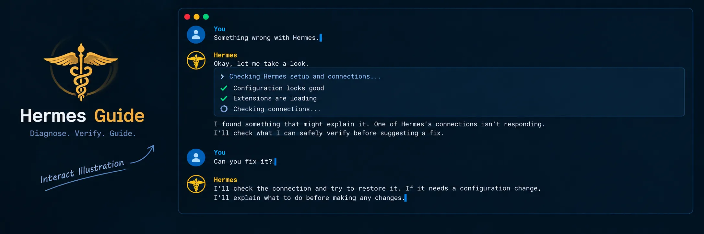

# Hermes Guide

> **Package / slug:** `hermes-guide` · **Catalog:** curated Hermes plugin catalog (community tier)



Hermes usage and self-diagnosis guide for [Hermes Agent](https://github.com/NousResearch/hermes-agent).
It is an independent community project: not a Hermes core component, and it does
not ask upstream to change for this plugin's benefit. Genuine Hermes defects
found during diagnosis may still be reported upstream.

It **complements — never replaces —** Hermes's own diagnostics (`hermes doctor`, `hermes verify`, and the per-surface helpers): it covers the gaps they leave. The plugin is **read-only** (no config writes; empty `capabilities:`). It ships two independent things:

1. **A plugin.** `/hermes-doctor` in a session, `hermes guide` in a terminal. Read-only health checks across <!-- BEGIN GENERATED: intro-scopes -->
`config`, `mcp`, `skills`, `commands`, `hooks`, `plugins`, `memories`, `sessions`, `update`
<!-- END GENERATED: intro-scopes --> — every one of those names is a valid scope.
2. **A skills tap.** <!-- BEGIN GENERATED: intro-inventory -->
**Twenty-two troubleshooting skills** — one install guide, one configuration map, nineteen per-surface `diagnosing-*` playbooks, one other skill (`hermes-post-update`).
<!-- END GENERATED: intro-inventory -->

Enabling the plugin additionally registers one router skill (`hermes-guide:start`) in
model sessions: it routes "something is wrong" reports to `hermes guide` and, once
the tap is installed, to the matching playbook. The playbooks themselves ship only
via the tap.

**Who it's for.** A session helping someone who does not read Hermes's source: the
plugin gives it a deterministic picture of the host, the tap gives it the per-surface
playbook, and each finding gives a reason and, where the check has one, the path or
output behind it. That is what lets a problem be triaged before an upstream fix
lands — and what lets an upstream maintainer act on a report without re-deriving
the user's environment. Read-only throughout: no config writes, no auto-fix.

> [!NOTE]
> The `hooks` check runs `hermes hooks doctor`, which executes each approved
> shell hook once with a synthetic payload — that is how it verifies a hook
> actually runs. Proactive runs do not execute hooks: they inspect hook
> configuration in-process (allowlist state, exec bit) instead.

## Install the plugin

From the curated catalog (preferred):

```bash
hermes plugins install hermes-guide
hermes plugins enable hermes-guide
```

Catalog installs land disabled — the `enable` step is what registers
`/hermes-doctor` and `hermes guide`. (Owner/repo installs pass `--enable`
inline instead.)

From GitHub by owner/repo (same package; useful to pin a SHA):

```bash
hermes plugins install iap/hermes-guide --enable
hermes plugins install iap/hermes-guide --ref <40-char-SHA> --enable
```

Requires Hermes `>=0.21` — declared as `requires_hermes` in `plugin.yaml` and
enforced by the plugin loader (a build without it records-and-skips at load).
See `hermes plugins info hermes-guide` for the
catalog pin and disclosure text.

### Manual install

Alternatively, clone this repo into your Hermes plugins directory:

```bash
# POSIX / WSL: $HERMES_HOME is ~/.hermes
git clone --depth 1 https://github.com/iap/hermes-guide ~/.hermes/plugins/hermes-guide
hermes plugins adopt hermes-guide
hermes plugins enable hermes-guide
```

Adopting registers the self-cloned directory in provenance tracking so
`hermes plugins update` covers it. Prefer a fresh clone over `cp -r .`: it leaves working-tree caches and build
artifacts (`__pycache__`, venvs) behind. Keep the clone's `.git` — Hermes
updates Git-managed plugins in place, and deleting it breaks those updates.
Only delete `.git` for a standalone archive copy that will never be updated
as a plugin.

> [!NOTE]
> On native Windows `$HERMES_HOME` is `%LOCALAPPDATA%\hermes`, not `~/.hermes`. Run `hermes config path` to confirm where yours is.

## Use the plugin

- **In a session:** `/hermes-doctor` for every surface, or `/hermes-doctor mcp` for one.
- **In a terminal:** `hermes guide`. Exits `1` if any surface is broken or unknown, `2` for an unrecognized scope name, `0` when healthy. On a degraded host — where every `hermes` launch replays a minutes-long update tail — `hermes guide --fast` runs all nine checks in-process with no subprocess.
- **Machine-readable:** `hermes guide mcp --json` prints one JSON document instead of the report — envelopes unchanged, top-level `status` derived, update notice suppressed (exit codes above still apply). Agents and scripts parse that document; plain `grep`-style consumers keep the text output.

### Proactive mode (opt-in)

Add to `config.yaml`:

```yaml
plugins:
  entries:
    hermes-guide:
      settings:
        proactive: true
```

Drift findings are then logged at session start/end — watch `hermes logs --follow`.

## Install the skills

Installing the plugin does **not** install the skills; they ship as separate, opt-in reference material. Add the repo as a skills tap, then install what you want:

```bash
hermes skills tap add iap/hermes-guide
hermes skills install iap/hermes-guide/skills/diagnosing-mcp
```

> [!IMPORTANT]
> The identifier must include the `skills/` prefix — it is the repo-relative path to the skill's `SKILL.md`. The shorter `iap/hermes-guide/<name>` form does not resolve.

### Install all skills at once

<!-- BEGIN GENERATED: install-all-loop -->
```bash
for s in diagnosing-auth diagnosing-bot-mode diagnosing-browser diagnosing-cli-tui diagnosing-commands diagnosing-cron diagnosing-desktop diagnosing-gateway diagnosing-hooks diagnosing-host-pressure diagnosing-mcp diagnosing-memory diagnosing-path diagnosing-plugins diagnosing-providers diagnosing-runtime diagnosing-skills diagnosing-triage diagnosing-voice hermes-configuration-guide hermes-post-update installing-hermes; do hermes skills install "iap/hermes-guide/skills/$s"; done
```
<!-- END GENERATED: install-all-loop -->

Each skill still passes its own scan and consent individually, so it stays individually updatable. Every installed skill is also available as a slash command (e.g. `/diagnosing-mcp`).

## What's included

| Skill | Purpose |
|---|---|
| `installing-hermes` | Install routes — install.sh/Desktop/Nix, what each creates on disk, config bootstrap, update/uninstall, and the gotchas (PM-era runtime layout, NixOS specifics) |
| `hermes-configuration-guide` | The map: resolving `$HERMES_HOME`, where each surface is configured, instruction files, orphaned/legacy settings, and routing to the diagnostic skills |
| `hermes-post-update` | Verify and clean up after a Hermes update — gateway restart, plugin migrations, config changes, health checks, cleanup opportunities |
| `diagnosing-mcp` | MCP servers that won't connect, expose no tools, fail OAuth, or ignore `mcp_servers:` config |
| `diagnosing-skills` | Skills not discovered, shadowed, hidden by platform/toolset conditions, or stuck "user-modified" |
| `diagnosing-commands` | Missing or overridden slash commands — skills-as-commands, bundles, plugin commands, per-platform permissions |
| `diagnosing-hooks` | Hooks that don't fire — the four hook systems, shell-hook consent, `hermes hooks doctor` |
| `diagnosing-plugins` | Plugins that don't load — the `plugins.enabled` gate, capability consent, discovery locations |
| `diagnosing-path` | Path issues — the dual-venv layout on older checkouts, the PM-era no-in-tree-venv case, detection, canonical resolution order, cross-platform best practices |
| `diagnosing-triage` | Route vague user descriptions to the correct diagnostic skill — a triage layer that maps symptoms to the right `diagnosing-*` playbook |
| `diagnosing-cli-tui` | CLI/TUI issues on native Windows — rendering artifacts, themes, busy indicators, mouse modes, encoding, launch/resume |
| `diagnosing-auth` | Hub-install auth failures — dead/shadowing `GITHUB_TOKEN` in the profile `.env`, `gh-cli` fallback, 401 vs anonymous probes, rate-limit verdicts |
| `diagnosing-memory` | Memory problems — built-in `MEMORY.md`/`USER.md` stores, external providers configured but silently unavailable, missing plugins/keys, char-limit and approval gates |
| `diagnosing-desktop` | Desktop app build/launch failures — npm/Node issues, locked or torn builds, Electron download fallbacks, backend resolution, `desktop.*` config |
| `diagnosing-providers` | Model provider issues — custom endpoints flooding the picker with hundreds of models, `discover_models` misbehaving, persisted catalogs bloating `config.yaml`, provider/auth failures |
| `diagnosing-bot-mode` | Bot Mode issues — bots not appearing, profile conflicts, bot-to-bot messaging, model/memory/skill routing per bot |
| `diagnosing-voice` | Voice mode issues — STT/TTS provider failures, audio device problems, latency, ffmpeg missing, voice transcription |
| `diagnosing-browser` | Browser automation issues — CDP connection failures, Chrome 144+ compatibility, Playwright setup, agent-browser gating |
| `diagnosing-cron` | Cron job issues — jobs not firing, scheduler dead, wedged fire-claim, timezone issues, delivery failures |
| `diagnosing-gateway` | Gateway & messaging issues — bot not responding, platform allowlist, token validation, gateway connectivity |
| `diagnosing-host-pressure` | Host resource exhaustion presenting as multiple Hermes faults — load-vs-CPU, plugin load-budget discards, resolution order |
| `diagnosing-runtime` | Runtime failures — CLI produces no output, commands hang or return empty, stuck source updates, broken node deps, recovery routes |

## Design principle

**Complement, don't duplicate.** When a built-in already answers the question, use it — hermes-guide exists for the gaps: deep per-surface playbooks, deterministic read-only health checks, and the routing map between surfaces. If a check here ever starts duplicating a built-in, the built-in wins and the check gets trimmed.

Every diagnosis resolves to a concrete action: a `hermes <subcommand>` command or a specific file + field edit, then a `/reload-*` or restart to apply.

## Contributing

Skills track the Hermes Agent source and its shipped documentation (`website/docs/` in `hermes-agent`). When Hermes changes behavior, update the affected skill and bump its `version`. See [CONTRIBUTING.md](CONTRIBUTING.md).

| Audience | Start here |
|---|---|
| End users / catalog install | This README |
| Human contributors (skills, PRs, voice) | [CONTRIBUTING.md](CONTRIBUTING.md) |
| Agents working in this repo | [AGENTS.md](AGENTS.md) (always-on) → [docs/agent/](docs/agent/README.md) (on demand) |
| Security / read-only contract | [SECURITY.md](SECURITY.md) |
| App builders / host integration | [docs/embedding.md](docs/embedding.md) |

## License

MIT — see [LICENSE](LICENSE).
